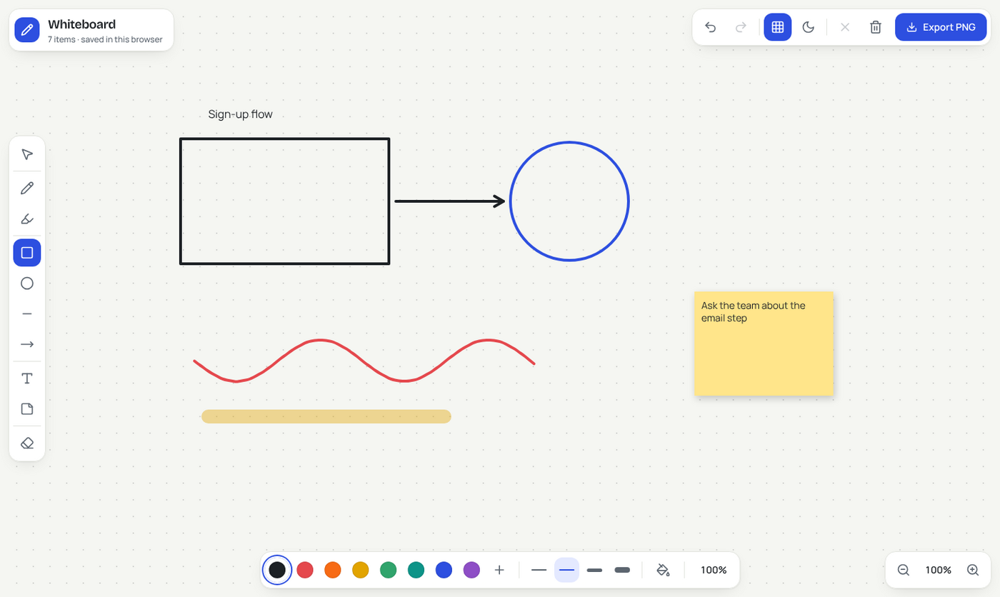
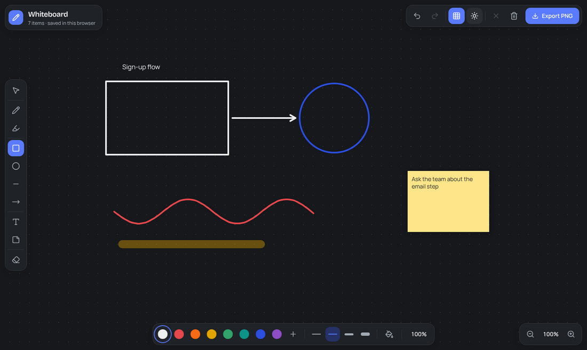

<div align="center">

# 🖊️ Digital Whiteboard

A browser whiteboard for sketches, diagrams and quick notes, built with Next.js, React and the HTML Canvas API. Draw freehand, add shapes, text and sticky notes, then export your board as a PNG.




</div>

---

## Features

**Interface**
- Full-screen canvas with floating panels: a tool rail on the left, history and export at the top right, a style bar at the bottom and zoom controls in the corner
- Drafting-paper look: dot grid on a warm off-white board, graphite UI and a single marker-blue accent
- Light and dark boards; the default ink colour switches between near-black and near-white so drawings stay visible
- Friendly empty state with keyboard hints, tooltips that show each shortcut, and a confirm step before clearing the board
- Responsive down to phone width, visible keyboard focus and reduced-motion support

**Drawing tools**
- **Pen:** smooth freehand strokes (quadratic-curve smoothing)
- **Highlighter:** wide, semi-transparent strokes
- **Shapes:** rectangle, circle, line and arrow, with an optional solid fill
- **Text:** click anywhere to type, font size 8–72 px
- **Sticky notes:** six colours, text wraps automatically
- **Eraser:** removes individual elements without clearing the board

**Editing**
- Select tool to pick an element, drag it to move it, and press <kbd>Delete</kbd> to remove it
- Undo and redo with full history
- Clear the whole board (with a confirm step, and Undo still works afterwards)

**Canvas controls**
- Eight preset colours plus a custom colour picker
- Four stroke weights (2, 4, 8 and 14 px) and opacity 10–100 %
- Zoom from 20 % to 500 %
- Dot grid on or off
- Light and dark boards

**Saving**
- Export the board as a PNG image
- Auto-save to `localStorage`, so your drawing is still there after a refresh

## Keyboard shortcuts

| Key | Action | Key | Action |
|---|---|---|---|
| <kbd>V</kbd> | Select | <kbd>T</kbd> | Text |
| <kbd>P</kbd> | Pen | <kbd>S</kbd> | Sticky note |
| <kbd>H</kbd> | Highlighter | <kbd>E</kbd> | Eraser |
| <kbd>R</kbd> | Rectangle | <kbd>+</kbd> / <kbd>=</kbd> | Zoom in |
| <kbd>C</kbd> | Circle | <kbd>-</kbd> | Zoom out |
| <kbd>L</kbd> | Line | <kbd>0</kbd> | Reset zoom |
| <kbd>A</kbd> | Arrow | <kbd>Ctrl</kbd>+<kbd>Z</kbd> / <kbd>Ctrl</kbd>+<kbd>Y</kbd> | Undo / Redo |
| <kbd>Delete</kbd> | Delete selected element | | |

On macOS use <kbd>Cmd</kbd> instead of <kbd>Ctrl</kbd>.

## Dark board



## How it works

Every stroke, shape, text block and sticky note is stored as an element object (type, points, colour, width, opacity). The canvas is redrawn from that list on every change, which makes undo/redo, selection, moving, erasing and saving simple: history is a list of element snapshots, and auto-save writes the current list to `localStorage`.

## Tech stack

| Layer | Tools |
|---|---|
| Framework | Next.js 16 (App Router), React 19 |
| Language | TypeScript |
| Drawing | HTML5 Canvas 2D API |
| UI | Tailwind CSS 4, shadcn/ui (tooltip, popover, slider, alert dialog), Lucide icons, Bricolage Grotesque + Manrope via Fontsource |
| Persistence | Browser `localStorage` |

## Getting started

**Requirements:** Node.js 18.18 or newer.

```bash
git clone https://github.com/ZainAftab-dev/Digital-Whiteboard-App.git
cd Digital-Whiteboard-App
npm install
npm run dev
```

Open [http://localhost:3000](http://localhost:3000). For a production build: `npm run build` then `npm start`.

## Project structure

```
app/
├── layout.tsx                        # root layout and metadata
├── page.tsx                          # renders <Whiteboard />
└── globals.css
components/
├── whiteboard.tsx                    # state: elements, history, tools, viewport, shortcuts, auto-save, export
└── whiteboard/
    ├── whiteboard-toolbar.tsx        # tools, colours, stroke/opacity, zoom, grid, theme, undo/redo, clear, export
    ├── whiteboard-canvas.tsx         # canvas rendering and mouse handling
    ├── whiteboard-text-input.tsx     # inline text editor
    └── sticky-note-input.tsx         # sticky-note editor with colour picker
lib/
└── whiteboard-types.ts               # Tool, DrawElement, Point, HistoryState, ViewportState
```

## Deployment

Import the repository into [Vercel](https://vercel.com/new) and deploy with the default settings. No environment variables are needed.

## Author

**Zain Aftab** · [GitHub](https://github.com/ZainAftab-dev) · [LinkedIn](https://www.linkedin.com/in/zain-aftab-563727295/)

## License

[MIT](LICENSE)
